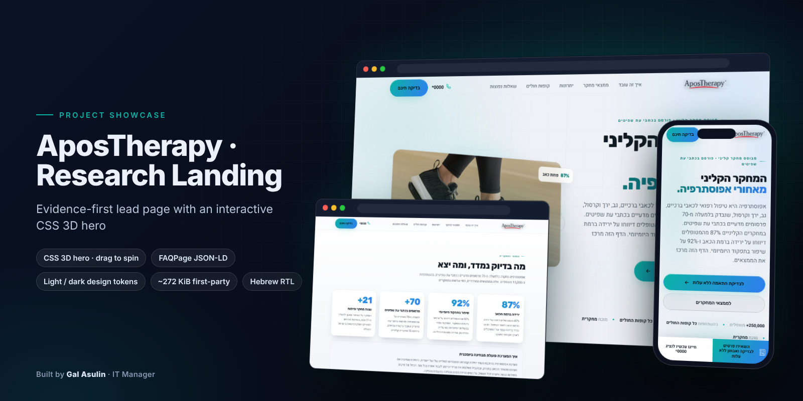
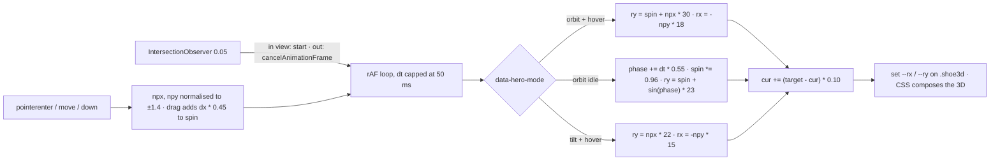

<p align="center"><a href="https://galasulin.github.io/apostherapy-research-landing/"></a></p>

<div align="center">

# אפוסתרפיה · דף נחיתה שמוביל עם המחקר

**דף לידים שנפתח בראיות הקליניות, ובראשו כרטיס מוצר אינטראקטיבי ב-CSS 3D שאפשר לרחף מעליו, להטות אותו ולגרור כדי לסובב.**

🇬🇧 [English](README.md) · 🇮🇱 עברית

[](https://galasulin.github.io/apostherapy-research-landing/)


<br>


[דמו חי](https://galasulin.github.io/apostherapy-research-landing/) · [מסכים](#מסכים) · [ארכיטקטורה](#ארכיטקטורה) · [טכני](#פרמטרים-טכניים)

<sub>בדף החי מעבירים את העכבר מעל כרטיס הנעל או גוררים אותו.</sub>

</div>

<div dir="rtl" align="right">

> **מאגר תצוגה.** עותק סטטי ומנוקה של דף נחיתה שרץ בפרודקשן על הדומיין של החברה. הוסרו ממנו מנהל התגים, החיבור ל-CRM לקליטת לידים, תוסף הנגישות החיצוני וכל מספרי הטלפון האמיתיים. הטופס עדיין מבצע ולידציה, אבל לא שולח כלום: שליחה תקינה מציגה רק הודעת הדגמה. פירוט מלא ב[פרטיות והיקף](#פרטיות-והיקף).

## במבט מהיר

| | |
|---|---|
| **סוג** | דף נחיתה לקליטת לידים, שפותח בראיות |
| **סטטוס** | חי בפרודקשן על הדומיין של החברה · הריפו הזה הוא העותק המנוקה |
| **סטאק** | HTML5 · ‏CSS (‏3D transforms, טוקנים במשתני CSS) · JavaScript נקי · JSON-LD של schema.org |
| **התפקיד שלי** | מבנה התוכן, השפה החזותית, פיתוח Front-end והעברה לפרודקשן |
| **דמו חי** | [galasulin.github.io/apostherapy-research-landing](https://galasulin.github.io/apostherapy-research-landing/) |
| **שפות** | ממשק בעברית (RTL) · תיעוד באנגלית ובעברית |

## מסכים

<table>
  <tr>
    <td width="33%"><a href="assets/desktop-hero.png"></a><br><sub><b>ראש הדף</b> · כרטיס מוצר בתלת-ממד עם שבבים מרחפים</sub></td>
    <td width="33%"><a href="assets/desktop-stats.png"></a><br><sub><b>נתוני המחקר</b> · המונים נספרים כשהם נכנסים למסך</sub></td>
    <td width="33%"><a href="assets/desktop-evidence.png"></a><br><sub><b>ממצאים</b> · מה נמדד, ומה יצא</sub></td>
  </tr>
  <tr>
    <td width="33%"><a href="assets/desktop-form.png"></a><br><sub><b>טופס לידים</b> · בחירת אזור, אישור, שדה מלכודת</sub></td>
    <td width="33%"><a href="assets/desktop-form-demo.png"></a><br><sub><b>טופס (הדגמה)</b> · הודעת הדגמה והודעה קופצת לטלפון</sub></td>
    <td width="33%" align="center"><a href="assets/mobile.png"></a><br><sub><b>מובייל</b> · הטקסט קודם, פס פעולות דביק בתחתית</sub></td>
  </tr>
</table>

## מה זה

דף לידים של אפוסתרפיה, טיפול לא ניתוחי בכאבי ברכיים, גב, ירך וקרסול. במקום לפתוח ביתרונות, הדף פותח **בראיות**: 87% דיווחו על פחות כאב, 92% על שיפור בתפקוד, יותר מ-70 פרסומים בכתבי עת שפיטים, יותר מ-250,000 מטופלים. הוא מוביל מבקר ספקן מהמספרים, דרך *מה נמדד ואיך*, אל השאלות הנפוצות ואל טופס אחד.

הדף נמסר **כתיקייה שמחליפה את הדף הקודם אחד לאחד**: אותם שמות שדות בטופס ואותן מחלקות עוגן (`.open-btn`, ‏`.call-btn`, ‏`.warning`, ‏`.bdika-text`), כך שסקריפט הלידים הקיים בפרודקשן המשיך לעבוד בלי שינוי.

## יכולות מרכזיות

**הירו אינטראקטיבי בתלת-ממד**
- צילום המוצר יושב על כרטיס ב-CSS 3D אמיתי: `perspective: 1500px`, ‏`transform-style: preserve-3d`, הכרטיס על `translateZ(40px)`, שלושה שבבי זכוכית על `translateZ(70 / 95 / 120px)`, צל על `-30px` וטבעת רצפה מוטה ב-`rotateX(74deg)`.
- מנוע `requestAnimationFrame` קטן ב-`app.js` מניע אותו: נדנוד מסלולי במנוחה (גל סינוס), הטיה שעוקבת אחרי העכבר בריחוף, ו**גרירה לסיבוב** עם תנופה שדועכת (`spin *= 0.96`), הכול מוחלק ב-lerp.
- שלושה מצבים (`orbit` / `tilt` / `stage`) מתחלפים בתכונה אחת, `data-hero-mode`. המצב `stage` הוא keyframes של CSS בלבד, בלי לולאת JS.
- הלולאה נעצרת כשההירו יוצא מהמסך (`IntersectionObserver`) ונרגעת כשהמשתמש ביקש הפחתת תנועה.

**תוכן שפותח בראיות**
- המונים (`87%`, ‏`92%`, ‏`250,000+`, ‏`70+`) נספרים כלפי מעלה בעקומת ease-out-cubic כשהם נכנסים למסך, בעיצוב של `toLocaleString`.
- ארבעה כרטיסי תוצאות, הסבר בשפה פשוטה על *איך המערכת פועלת מבחינה ביומכנית* והסתייגות כנה לגבי התוצאות. זו הזווית שהדף נבנה סביבה.
- חשיפות מדורגות בגלילה: צופה אחד מוסיף `.in` לכל `.reveal`; ‏`data-d="1..4"` מדרג את ההשהיות.

**שאלות נפוצות לאנשים ולמנועי חיפוש**
- שאלות נפוצות גלויות שבנויות על `<details>` מקורי (נגיש במקלדת, בלי JS), ומשוכפלות בגרף JSON-LD מסוג `FAQPage`, כך שאותן תשובות זמינות גם לתוצאות עשירות ולמנועי תשובות מבוססי AI.

**טוקנים של עיצוב**
- כל צבע, רדיוס, צל ופונט הוא משתנה CSS. ערכות טוקנים בהירה וכהה מתחלפות עם `data-theme`, וזוגות פונטים עם `data-font` על `<html>`.
- שבבי זכוכית (`backdrop-filter`), גרדיאנט רשת נודד ורשת עם מסכה נותנים עומק בלי תמונות נוספות.

**ביצועים**
- תמונת ההירו נטענת מראש עם `fetchpriority="high"` ומוגשת כ-WebP עם גיבוי JPEG ‏(`<picture>` ו-`image-set()` ב-CSS).
- לכל תמונה מידות מפורשות; תמונות מתחת לקו הגלילה נטענות בעצלתיים.
- הסרטון מ-YouTube הוא חזית שנטענת בלחיצה: שום דבר לא מתבקש מ-YouTube עד שהגולש לוחץ Play, ואז נטען `youtube-nocookie.com`.

**נגישות**
- קישור דילוג, טבעות פוקוס בולטות, תוויות לכל שדה, `role="radiogroup"` לאזור המגורים, אזהרות `role="alert"` עם `aria-invalid`, פוקוס לשדה השגוי הראשון, אזורי מגע של 44 פיקסלים, ותוכן חלופי ב-`noscript`.
- `prefers-reduced-motion` מכבה כל אנימציה ומעבר, ומציג את כל התוכן הנחשף מיד.

## ארכיטקטורה


הדף סטטי: `index.html` מחזיק את ה-markup ואת גרף ה-JSON-LD, ‏`style.css` מחזיק את הטוקנים, במת התלת-ממד וכללי הרספונסיביות, ושני סקריפטים דחויים מוסיפים התנהגות. ‏`app.js` (נשאר כמו בפרודקשן) אחראי על מצב הניווט, מנוע ההירו בתלת-ממד, החשיפות והמונים. ‏`demo-form.js` מחליף את סקריפט הלידים של הפרודקשן: אותה ולידציה ואותם עוגני אזהרה, ועוד הודעות ההדגמה והסרטון שנטען בלחיצה. מנוע ההירו כותב רק שני משתני CSS, ‏`--rx` ו-`--ry`, על `.shoe3d`; את כל הרכבת התלת-ממד עושה ה-CSS. הנכסים הם קבצים רגילים ב-GitHub Pages; בטעינה השרת החיצוני היחיד הוא Google Fonts.

### זרימה



## פרמטרים טכניים

| פרמטר | ערך |
|---|---|
| קובצי מקור | `index.html` ‏37,376 בייט · `style.css` ‏33,322 בייט (666 שורות) · `app.js` ‏4,811 בייט (113 שורות) · `demo-form.js` ‏4,510 בייט · `accessibility.html` ‏4,600 בייט |
| משקל הדף מנכסים עצמיים | 278,384 בייט (כ-272KiB) בדפדפן שתומך ב-WebP: HTML, ‏CSS, שני הסקריפטים, favicon, ‏WebP של ההירו, לוגואים ואייקונים. לא כולל פונטים ותמונת השיתוף |
| תמונת ההירו | `shoe-hero.webp` ‏1400 × 805, ‏70,242 בייט · גיבוי JPEG ‏1740 × 1000, ‏201,356 בייט |
| תמונות נוספות | 4 לוגואים של קופות החולים (PNG בגובה 75 פיקסלים) · לוגו המותג 660 × 150 · 2 אייקונים קטנים · תמונת שיתוף 1200 × 628 |
| במת התלת-ממד | גובה 620 פיקסלים (520 ב-980 ומטה, 400 ב-680 ומטה) · `perspective: 1500px` · נקודת מוצא 50% 45% |
| שכבות עומק | כרטיס `translateZ(40px)` · שבבים 70 / 95 / 120 פיקסלים · צל ‎−30 פיקסלים · רצפה `rotateX(74deg)` |
| מנוע ההירו | lerp ‏0.10 · דעיכת סיבוב 0.96 לפריים · גרירה 0.45° לפיקסל · נדנוד במנוחה ±23° (ציר Y), ‏±4° (ציר X) · הטיה בריחוף ±30° / ±18° (‏orbit), ‏±22° / ±15° (‏tilt) · `dt` מוגבל ל-50 מילישניות |
| לולאות CSS | ריחוף 7 שניות · טבעת מסלול 14 שניות · נדידת רשת 18 שניות · ברק 2.4 שניות בריחוף |
| מונים | 4 ערכים · 1,500 מילישניות ב-ease-out-cubic · מתחילים ב-60% נראות |
| חשיפות | סף 0.16 · `rootMargin: 0px 0px -8% 0px` · מדרגות של 80 / 160 / 240 / 320 מילישניות |
| נתונים מובנים | `@graph` של JSON-LD: ‏`WebPage`, ‏`WebSite`, ‏`Organization`, ‏`FAQPage` עם 6 שאלות · 6 פריטי `<details>` גלויים |
| ערכות נושא | ערכת טוקנים בהירה (ברירת מחדל) וכהה · זוגות פונטים עם `data-font`; הדף טוען Rubik ו-Heebo לזוג ברירת המחדל |
| נקודות שבירה | 440 · 680 · 980 · 1080 פיקסלים · פס פעולות דביק במובייל ב-680 ומטה |
| פונטים | Rubik במשקלים 400 עד 800 (כותרות) · Heebo במשקלים 300 עד 800 (גוף) · Google Fonts עם `display=swap` |
| שרתים חיצוניים | בטעינה: `fonts.googleapis.com`, ‏`fonts.gstatic.com` · רק אחרי Play: ‏`youtube-nocookie.com` |
| תלויות / build | אין / אין |

## החלטות הנדסיות

- **ה-CSS עושה את התלת-ממד, ה-JS קובע שני מספרים** ← המנוע כותב רק את `--rx` / `--ry`; שכבות, עומק ותאורה נשארים ב-CSS, שם קל לעצב אותם מחדש. המחיר: אפקט התלת-ממד הוא כרטיס בחלל, לא מודל תלת-ממד אמיתי.
- **lerp לעבר יעד במקום אנימציה ישירה** ← ריחוף, גרירה ונדנוד במנוחה מתמזגים לתנועה חלקה אחת בלי מכונת מצבים. תנופה היא הכפלה אחת לכל פריים.
- **עצירה מחוץ למסך** ← `IntersectionObserver` מבטל את לולאת ה-rAF כשההירו לא גלוי, כך שהדף לא עולה כלום בזמן שהגולש קורא בהמשך.
- **שאלות נפוצות גלויות שמשוכפלות ב-JSON-LD** ← מקור תשובות אחד משרת אנשים, תוצאות עשירות ומנועי תשובות מבוססי AI. המחיר: שני עותקים שצריך לשמור מסונכרנים.
- **החלפה אחד לאחד עם העוגנים הישנים** ← שמירה על שמות השדות ומחלקות העוגן אפשרה לסקריפט הלידים, למעקב ולמעקב השיחות בפרודקשן להמשיך לעבוד בלי שינוי בצד השרת.
- **סרטון שנטען בלחיצה** ← אין בקשה לצד שלישי ואין עוגיות עד שהגולש מבקש את הסרטון.

## סטטוס והתפקיד שלי

**חי בפרודקשן על הדומיין של החברה.** הריפו הזה הוא עותק מנוקה לתיק עבודות: המעקב הוסר, הטופס מנותק, ומספרי הטלפון הוחלפו ב-`*0000` מזויף שמציג רק הודעת הדגמה. הדף מסומן `noindex` כדי שלא יתחרה בדף החי בחיפוש. בפרודקשן זה דף PHP עם מספרי מעקב שיחות לכל מקור תנועה בצד השרת, מנהל תגים וחיבור ל-CRM לקליטת לידים (כולם הוסרו כאן).

עיצבתי ובניתי את הדף מקצה לקצה: מבנה התוכן שפותח במחקר, השפה החזותית וההירו בתלת-ממד, קוד האינטראקציה, הנתונים המובנים ומעבר הנגישות, וההעברה לפרודקשן כתיקייה שמחליפה את הקודמת ושומרת על צנרת הלידים והמעקב הקיימים.

## מבנה הריפו

```
apostherapy-research-landing/
├── index.html          page + JSON-LD graph
├── style.css           design tokens, 3D stage, sections, responsive rules
├── app.js              3D hero engine, nav state, reveals, counters (as in production)
├── demo-form.js        demo form, toasts, click-to-load video; sends nothing
├── accessibility.html  short demo accessibility page
├── favicon.svg
├── images/             hero (WebP + JPEG), logos, fund logos, icons, share image
├── assets/             README screenshots
└── LICENSE
```

## פרטיות והיקף

| מה הוסר / הוחלף | איך |
|---|---|
| מנהל התגים, ה-iframe ב-`noscript` וכל אירועי `dataLayer` | הוסרו |
| החיבור ל-CRM, מפתחות הטופס והעברת UTM / מקור (קובץ `script.js` הישן) | הוחלפו ב-`demo-form.js`: אותה ולידציה, בלי שום בקשת רשת |
| jQuery מ-CDN ציבורי (רק סקריפט הלידים נזקק לו) | הוסר |
| לוגיקת טלפון בצד השרת (מספר מעקב לכל מקור פרסום, מקור שמסתיר את הטלפון) | הוסרה; כל קריאה לחיוג היא `*0000` מזויף שאי אפשר לחייג אליו (בלי קישור `tel:`) ומציג הודעת הדגמה |
| מספר הכוכבית וקישור WhatsApp בתוכן ה-`noscript` | הוחלפו בהודעת ההדגמה |
| תוסף נגישות חיצוני (עם מפתח האתר שלו) | הוסר |
| הצהרת נגישות עם פרטי קשר של עובדים | לא הועתקה; במקומה `accessibility.html` בלי פרטים אישיים |
| נגן YouTube מוטמע | הוחלף בתמונה שנטענת בלחיצה; שום דבר לא מתבקש מ-YouTube עד שלוחצים Play |
| טלפון החברה וקישורי הרשתות החברתיות בנתונים המובנים | הוסרו; `@id` / `url` מצביעים על העותק הזה |
| כתובות canonical ו-Open Graph | מצביעות על עותק ה-GitHub Pages הזה; הדף מסומן `noindex` |
| קישורים לאתר החברה (פרטיות, צור קשר) | מנוטרלים ומציגים הודעת הדגמה |
| `robots.txt`, `sitemap.xml`, `404.html`, הגדרות שרת, הוראות התקנה, תמונות שלא בשימוש | לא הועתקו |
| מטא-דאטה של תמונות (EXIF / XMP / טקסט) | נוקתה מכל התמונות |

השרתים החיצוניים היחידים שהדף טוען הם **Google Fonts** ‏(`fonts.googleapis.com`, `fonts.gstatic.com`), ובנוסף הדומיין ללא העוגיות של YouTube, רק אחרי שהגולש לוחץ Play.

השמות AposTherapy / APOS, הלוגואים וצילומי המוצר שייכים לבעליהם ומוצגים ברשות, לצורכי תיק עבודות בלבד. תיק עבודות לצפייה בלבד, ראו [LICENSE](LICENSE).

</div>

---

<div align="center"><b>Built by <a href="https://github.com/galasulin">Gal Asulin</a>, IT Manager</b></div>

<div align="center"><sub>דפי הנחיתה בתיק העבודות: <a href="https://github.com/galasulin/apos4-scroll-landing">apos4-scroll-landing</a> · <a href="https://github.com/galasulin/apos4-pods-landing">apos4-pods-landing</a> · <a href="https://github.com/galasulin/apostherapy-research-landing">apostherapy-research-landing</a></sub></div>
