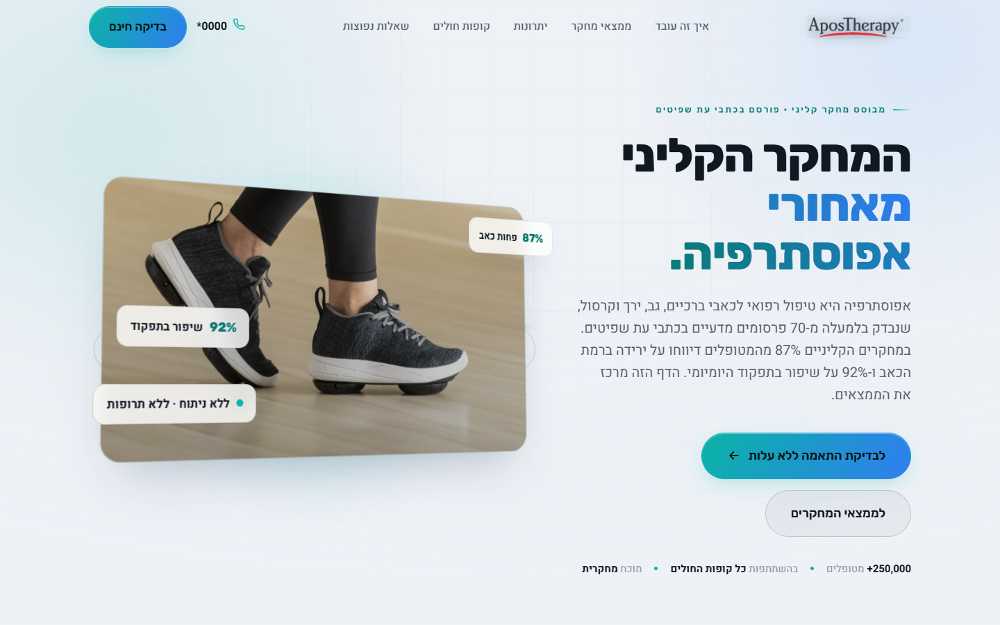
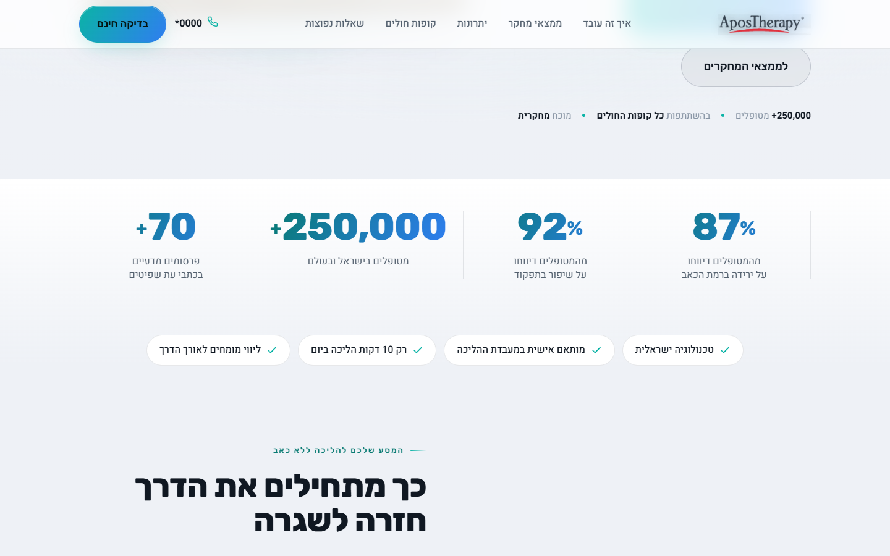
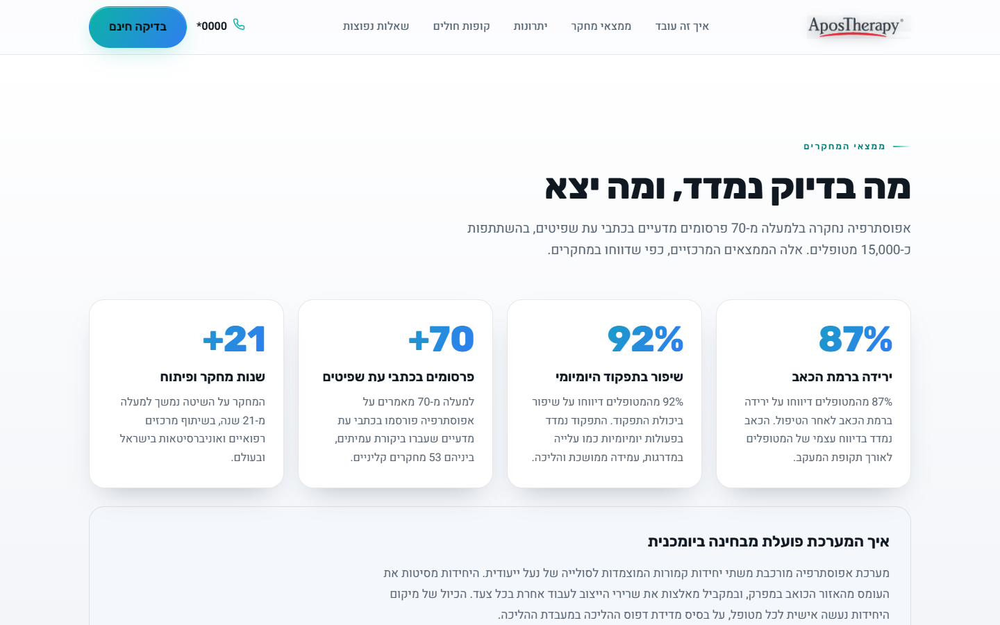
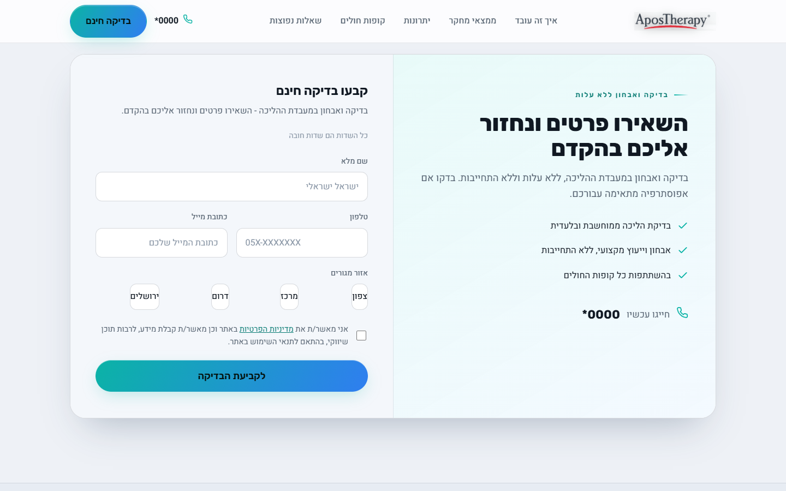
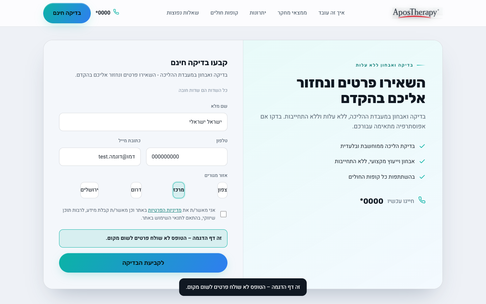
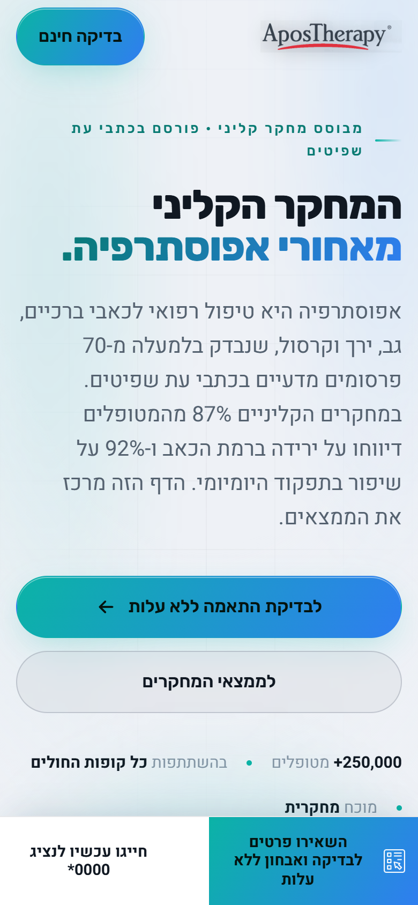

### אפוסתרפיה · דף נחיתה שמוביל עם המחקר, עם הירו בתלת-ממד

*כרטיס מוצר אינטראקטיבי בתלת-ממד · מוני נתוני מחקר מונפשים · חשיפות בגלילה · שאלות נפוצות עם נתונים מובנים · עברית RTL*

 

**[▶ לדמו החי](https://galasulin.github.io/apostherapy-research-landing/)** · *העבירו את העכבר או גררו את כרטיס הנעל*

🇬🇧 [**English version**](README.md)

> **מאגר תצוגה.** זהו עותק סטטי ומנוקה של דף נחיתה שרץ בפרודקשן על הדומיין של החברה. הוסרו ממנו מנהל התגים, החיבור ל-CRM לקליטת לידים, תוסף הנגישות החיצוני וכל מספרי הטלפון האמיתיים. הטופס עדיין מבצע ולידציה, אבל לא שולח כלום: שליחה תקינה מציגה רק הודעת הדגמה.

---

## 📖 מה זה

דף הלידים מהדור השני של אפוסתרפיה, טיפול לא ניתוחי בכאבי ברכיים, גב, ירך וקרסול. [דף הלידים המקורי](https://github.com/galasulin/apostherapy-lead-landing) מוכר יתרונות; הדף הזה פותח **בראיות**: 87% דיווחו על פחות כאב, 92% על שיפור בתפקוד, יותר מ-70 פרסומים שפיטים, יותר מ-250,000 מטופלים. הוא מוביל מבקר ספקן מהמספרים, דרך *מה נמדד ואיך*, אל השאלות הנפוצות ואל טופס אחד.

הדף נמסר כ**תיקייה להחלפה ישירה** של הדף הישן: אותם שמות שדות ואותן מחלקות עוגן (`.open-btn`, `.call-btn`, `.warning`, `.bdika-text`), כך שסקריפט הלידים הקיים בפרודקשן המשיך לעבוד בלי שינוי.

## ✨ מה מיוחד בו

| | |
|---|---|
| **הירו אינטראקטיבי בתלת-ממד** | תמונת המוצר יושבת על כרטיס ב-CSS תלת-ממדי אמיתי (`perspective`, ‏`preserve-3d`, תגיות שצפות בשכבות `translateZ`). מנוע `requestAnimationFrame` קטן מניע אותו: נדנוד מסלול במנוחה (גל סינוס), הטיה שעוקבת אחרי העכבר, **גרירה לסיבוב** עם תנופה שדועכת (`spin *= 0.96`), והכול מוחלק ב-lerp. שלושה מצבים (`orbit` / ‏`tilt` / ‏`stage`) מתחלפים בתכונה אחת. הלולאה נעצרת כשההירו יוצא מהמסך (`IntersectionObserver`) ונרגעת במצב הפחתת תנועה. |
| **מונים שסופרים** | ‏`87%`, ‏`92%`, ‏`250,000+`, ‏`70+` עולים בעקומת ease-out כשהם נכנסים למסך, בפורמט `toLocaleString`. |
| **חשיפות מדורגות בגלילה** | צופה אחד מוסיף `.in` לכל אלמנט `.reveal`; ‏`data-d="1..4"` מדרג את ההשהיות, כך שכל סקשן "מתרכב" כשהוא מגיע. |
| **סקשן ממצאים** | ארבעה כרטיסי תוצאות, הסבר ביומכני בשפה פשוטה והסתייגות כנה לגבי התוצאות, הזווית שהדף נבנה בשבילה. |
| **שאלות נפוצות לאנשים ולמנועי חיפוש** | שאלות גלויות על בסיס `
` מקורי (נגיש במקלדת, בלי JS), משוכפלות בגרף JSON-LD מסוג `FAQPage`, כך שאותן תשובות זמינות לתוצאות מועשרות ולמנועי תשובות מבוססי AI. |
| **Design tokens** | כל צבע, רדיוס, צל וגופן הוא משתנה CSS; ערכות בהיר/כהה וזוגות גופנים חלופיים מתחלפים עם `data-theme` / ‏`data-font` על `<html>`. תגיות זכוכית, גרדיאנט רשת שנע ורשת ממוסכת נותנים עומק בלי תמונות. |
| **ביצועים** | תמונת ההירו נטענת מראש עם `fetchpriority="high"`, מוגשת כ-WebP עם גיבוי JPEG ‏(`<picture>` ו-`image-set()` ב-CSS), לכל תמונה מידות מפורשות, והשאר נטען בעצלות. |
| **נגישות** | קישור דילוג, מסגרות פוקוס בולטות, שדות עם תוויות, אזהרות עם `role="alert"`, אזורי מגע של 44 פיקסלים, חלופת `noscript`, ו-`prefers-reduced-motion` מכבה כל אנימציה. |

## 🖥️ צילומי מסך

<table>
  <tr>
    <td width="50%"> <b>נתוני המחקר</b> · המונים מונפשים כשהם נכנסים למסך.</td>
    <td width="50%"> <b>ממצאים</b> · מה נמדד ומה יצא.</td>
  </tr>
  <tr>
    <td width="50%"> <b>טופס לידים</b> · בחירת אזור, הסכמה, שדה מלכודת.</td>
    <td width="50%"> <b>טופס (הדגמה)</b> · שליחה תקינה מציגה רק הודעת הדגמה; כפתור החיוג מציג הודעה קופצת.</td>
  </tr>
  <tr>
    <td colspan="2" align="center"> <b>נייד</b> · הטקסט קודם, עם פס תחתון קבוע לטופס ולחיוג.</td>
  </tr>
</table>

## 🛠️ טכנולוגיות

- **HTML5 + CSS** (משתני CSS, טרנספורמציות תלת-ממד, `clamp()`, ‏`backdrop-filter`, מסכות) עם הגופנים **Rubik** ו-**Heebo** מ-Google Fonts.
- **JavaScript נקי** ‏(`app.js`): מנוע ההירו, חשיפות ומונים, כ-150 שורות, בלי תלויות.
- **JSON-LD של schema.org**: ‏`WebPage`, ‏`WebSite`, ‏`Organization`, ‏`FAQPage`.
- בפרודקשן: דף PHP עם מספרי מעקב שיחות בצד השרת לפי מקור תנועה, מנהל תגים וחיבור CRM לקליטת לידים (כולם הוסרו כאן).

## 👤 התפקיד שלי

תכננתי ובניתי את הדף מקצה לקצה: מבנה תוכן שמתחיל מהמחקר, השפה החזותית וההירו התלת-ממדי, קוד האינטראקציה, הנתונים המובנים ומעבר הנגישות, והמסירה לפרודקשן כתיקייה להחלפה ישירה ששמרה על צינור הלידים והמדידה הקיימים.

## 📌 סטטוס

**באוויר בפרודקשן על הדומיין של החברה.** המאגר הזה הוא עותק מנוקה לתיק עבודות: המדידה הוסרה, הטופס מנותק, ומספרי הטלפון הוחלפו ב-`*0000` מזויף שמציג רק הודעת הדגמה. הדף מסומן `noindex` כדי שלא יתחרה בדף החי בחיפוש.

## 🔒 פרטיות / מה הוסר

| מה הוסר / הוחלף | איך |
|---|---|
| מנהל התגים, ה-iframe ב-`noscript` וכל אירועי `dataLayer` | הוסרו |
| החיבור ל-CRM, מפתחות הטופס והעברת UTM / מקור (‏`script.js` הישן) | הוחלפו ב-`demo-form.js`: אותה ולידציה, בלי שום בקשת רשת |
| jQuery מ-CDN ציבורי (רק סקריפט הלידים נזקק לו) | הוסר |
| לוגיקת טלפון בצד השרת (מספר מעקב לכל מקור פרסום, מקור שמסתיר את הטלפון) | הוסרה; כל כפתור חיוג הוא `*0000` מזויף שלא ניתן לחייג אליו (בלי קישור `tel:`) ומציג הודעת הדגמה |
| מספר כוכבית וקישור וואטסאפ בחלופת ה-`noscript` | הוחלפו בהודעת ההדגמה |
| תוסף נגישות חיצוני (עם מפתח האתר שלו) | הוסר |
| הצהרת נגישות עם פרטי קשר של עובדים | לא הועתקה; במקומה `accessibility.html` בלי פרטים אישיים |
| נגן YouTube מוטמע | הוחלף בתמונה שנטענת בלחיצה; שום דבר לא נטען מ-YouTube עד שלוחצים על הפעלה |
| טלפון החברה וקישורי הרשתות בנתונים המובנים | הוסרו; ‏`@id`/‏`url` מצביעים על העותק הזה |
| כתובות canonical ו-Open Graph | מצביעות על עותק ה-GitHub Pages הזה; הדף מסומן `noindex` |
| קישורים לאתר החברה (פרטיות, צור קשר) | מנוטרלים ומציגים הודעת הדגמה |
| `robots.txt`, ‏`sitemap.xml`, ‏`404.html`, הגדרות שרת, הוראות התקנה, תמונות שלא בשימוש | לא הועתקו |
| מטא-דאטה של תמונות (EXIF / XMP / טקסט) | נוקתה מכל התמונות |

השרתים החיצוניים היחידים שהדף טוען הם **Google Fonts** ‏(`fonts.googleapis.com`, `fonts.gstatic.com`).

---

**Built by [Gal Asulin](https://github.com/galasulin), IT Manager**

דפי נחיתה נוספים: <a href="https://github.com/galasulin/apostherapy-lead-landing">apostherapy-lead-landing</a> · <a href="https://github.com/galasulin/apos4-scroll-landing">apos4-scroll-landing</a> · <a href="https://github.com/galasulin/apostherapy-case-study">apostherapy-case-study</a> 
© 2026 Gal Asulin · תיק עבודות לצפייה בלבד, ראו <a href="LICENSE">LICENSE</a>

