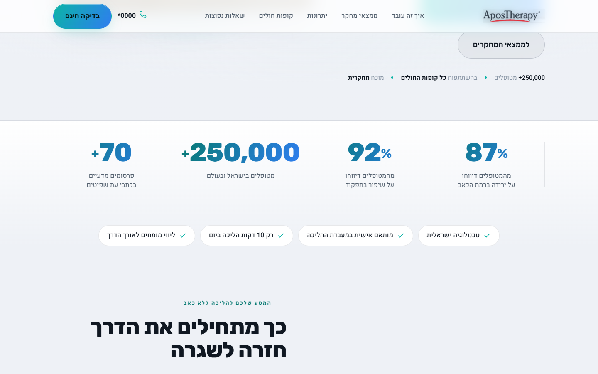
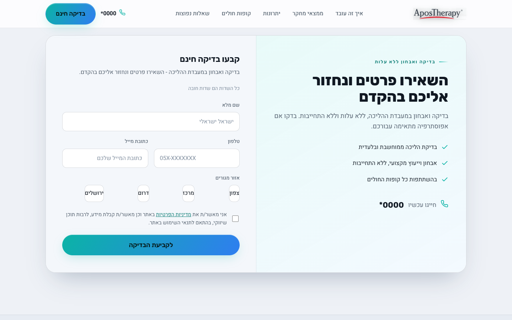
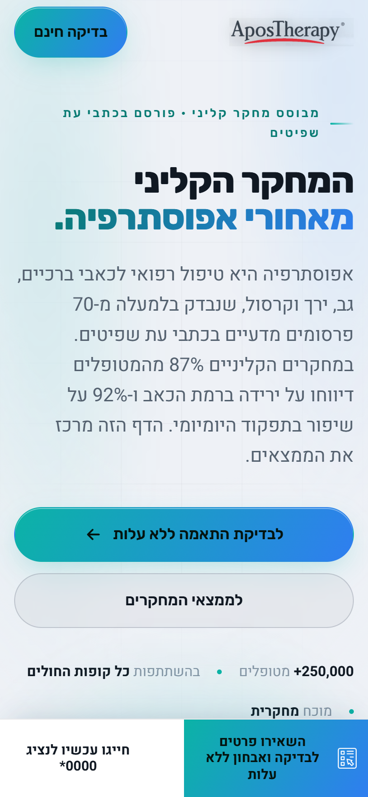

### AposTherapy · a research-led landing page with a 3D hero

*Interactive 3D product card · animated research counters · scroll reveals · FAQ backed by structured data · Hebrew RTL*

 

**[▶ Open the live demo](https://galasulin.github.io/apostherapy-research-landing/)** · *hover or drag the shoe card*

🇮🇱 [**גרסה עברית מלאה**](README.he.md)

> **Showcase repository.** This is a sanitized, static copy of a landing page that runs in production on the company's domain. The tag manager, the CRM lead endpoint, the third-party accessibility widget and every real phone number were removed. The form still validates, but it never sends anything: a valid submit only shows a demo notice. See [Privacy / what was removed](#-privacy--what-was-removed).

---

## 📖 What it is

The second-generation lead page for AposTherapy, a non-surgical treatment for knee, back, hip and ankle pain. Where the [original lead page](https://github.com/galasulin/apostherapy-lead-landing) sells benefits, this one leads with **the evidence**: 87% reported less pain, 92% better function, 70+ peer-reviewed publications, 250,000+ patients. The page walks a sceptical visitor from the numbers, through *what was measured and how*, to the FAQ and a single form.

It was delivered as a **drop-in replacement folder** for the old page: same form field names and the same hook classes (`.open-btn`, `.call-btn`, `.warning`, `.bdika-text`), so the existing production lead script kept working unchanged.

## ✨ What is special about it

| | |
|---|---|
| **Interactive 3D hero** | The product photo sits on a card in real CSS 3D (`perspective`, `preserve-3d`, chips floating on `translateZ` layers). A small `requestAnimationFrame` engine drives it: an idle orbit sway (sine wave), pointer-follow tilt on hover, **drag to spin** with momentum that decays (`spin *= 0.96`), all smoothed by lerp. Three modes (`orbit` / `tilt` / `stage`) switch with one attribute. The loop pauses when the hero leaves the screen (`IntersectionObserver`) and calms down under reduced motion. |
| **Counters that count** | `87%`, `92%`, `250,000+`, `70+` count up with an ease-out-cubic curve when they scroll into view, formatted with `toLocaleString`. |
| **Staggered scroll reveals** | One observer adds `.in` to each `.reveal` element; `data-d="1..4"` staggers the delays, so every section assembles itself as it arrives. |
| **Evidence section** | Four result cards plus a plain-language *how it works biomechanically* note and an honest results disclaimer, the angle this page was built for. |
| **FAQ for people and for search** | A visible FAQ built on native `
` (keyboard accessible, no JS), mirrored in a `FAQPage` JSON-LD graph, so the same answers are available to rich results and AI answer engines. |
| **Design tokens** | Every colour, radius, shadow and font is a CSS custom property; light/dark themes and alternative font pairings switch with `data-theme` / `data-font` on `<html>`. Glass chips, a drifting mesh gradient and a masked grid give depth without images. |
| **Performance** | The hero image is preloaded with `fetchpriority="high"`, served as WebP with a JPEG fallback (`<picture>` and CSS `image-set()`), every image has explicit dimensions, the rest lazy-load. |
| **Accessibility** | Skip link, visible focus rings, labelled fields, `role="alert"` warnings, 44 px targets, a `noscript` fallback, and `prefers-reduced-motion` turns off every animation. |

## 🖥️ Screenshots

<table>
  <tr>
    <td width="50%"> <b>Research numbers</b> · counters animate when they enter the screen.</td>
    <td width="50%"> <b>Evidence</b> · what was measured, and what came out.</td>
  </tr>
  <tr>
    <td width="50%"> <b>Lead form</b> · region picker, consent, honeypot.</td>
    <td width="50%"> <b>Form (demo)</b> · a valid submit only shows the demo notice; the phone CTA shows a toast.</td>
  </tr>
  <tr>
    <td colspan="2" align="center"> <b>Mobile</b> · the hero copy first, with a sticky bottom bar for the form and call actions.</td>
  </tr>
</table>

## 🛠️ Stack

- **HTML5 + CSS** (custom properties, CSS 3D transforms, `clamp()`, `backdrop-filter`, masks) with **Rubik** + **Heebo** from Google Fonts.
- **Vanilla JavaScript** (`app.js`): the 3D hero engine, reveals and counters, about 150 lines, no dependencies.
- **schema.org JSON-LD**: `WebPage`, `WebSite`, `Organization`, `FAQPage`.
- In production: a PHP page with server-side call-tracking numbers per traffic source, a tag manager and a CRM lead endpoint (all removed here).

## 👤 My role

I designed and built this page end to end: the research-first content structure, the visual system and the 3D hero, the interaction code, the structured data and the accessibility pass, and the production hand-off as a drop-in folder that kept the existing lead pipeline and tracking working.

## 📌 Status

**Live in production on the company domain.** This repo is a sanitized portfolio copy: tracking removed, form disconnected, phone numbers replaced with a fake `*0000` that only shows a demo notice. It is marked `noindex` so it never competes with the live page in search.

## 🔒 Privacy / what was removed

| Removed / replaced | How |
|---|---|
| Tag manager container + `noscript` iframe, all `dataLayer` events | Removed |
| CRM lead endpoint, form keys, UTM / source passthrough (the old `script.js`) | Replaced by `demo-form.js`: same validation, no network request |
| jQuery from a public CDN (only the lead script needed it) | Removed |
| Server-side phone logic (a tracking number per ad source, a source that hides the phone) | Removed; every phone CTA is a fake, non-dialable `*0000` (no `tel:` link) that shows a demo notice |
| Star number and WhatsApp link in the `noscript` fallback | Replaced with the demo notice |
| Third-party accessibility widget (with its site key) | Removed |
| Accessibility statement with staff contact details | Not copied; replaced by `accessibility.html` without personal details |
| Embedded YouTube player | Replaced by a click-to-load poster; nothing is requested from YouTube until you press play |
| Company phone and social links in the structured data | Removed; `@id`/`url` point at this copy |
| Canonical / Open Graph URLs | Pointed at this GitHub Pages copy; page marked `noindex` |
| Outbound links to the company site (privacy, contact) | Disabled; they show a demo notice |
| `robots.txt`, `sitemap.xml`, `404.html`, server config, install notes, unused images | Not copied |
| Image metadata (EXIF / XMP / text chunks) | Stripped from every image |

The only external hosts the page loads are **Google Fonts** (`fonts.googleapis.com`, `fonts.gstatic.com`).

## 📂 In this repository

| Path | What |
|---|---|
| [`index.html`](index.html) | The page, including the JSON-LD graph |
| [`style.css`](style.css) | Design tokens, 3D stage, sections, responsive rules |
| [`app.js`](app.js) | 3D hero engine, scroll reveals, counters (unchanged from production) |
| [`demo-form.js`](demo-form.js) | Demo form + click-to-load video, no sending |
| [`accessibility.html`](accessibility.html) | Short demo accessibility page |
| [`images/`](images) · [`assets/`](assets) | Page images · README screenshots |

---

**Built by [Gal Asulin](https://github.com/galasulin), IT Manager**

More landing pages: <a href="https://github.com/galasulin/apostherapy-lead-landing">apostherapy-lead-landing</a> · <a href="https://github.com/galasulin/apos4-scroll-landing">apos4-scroll-landing</a> · <a href="https://github.com/galasulin/apostherapy-case-study">apostherapy-case-study</a> 
© 2026 Gal Asulin · view-only portfolio, see <a href="LICENSE">LICENSE</a>

