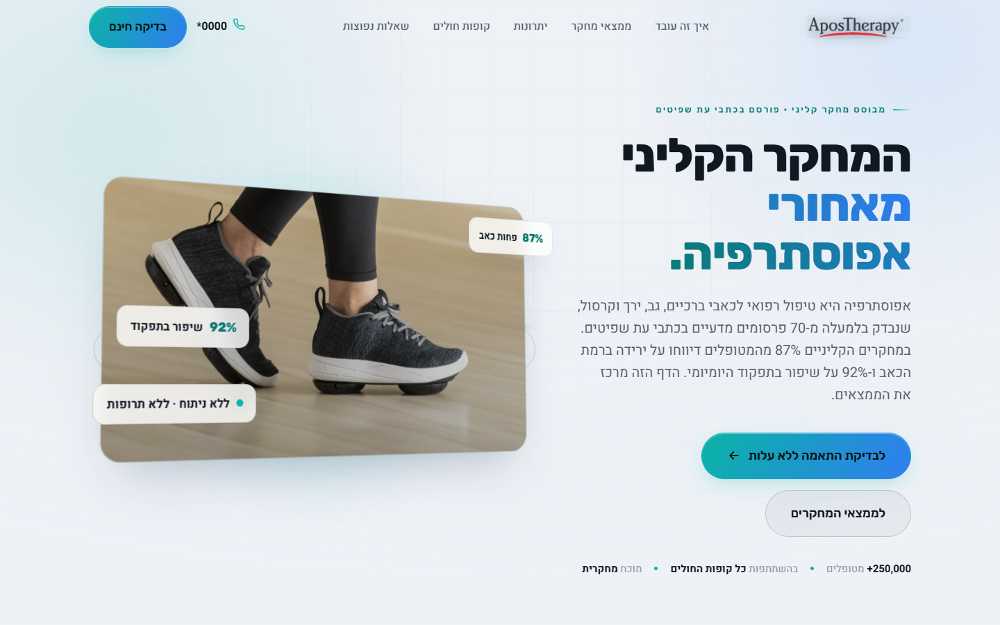
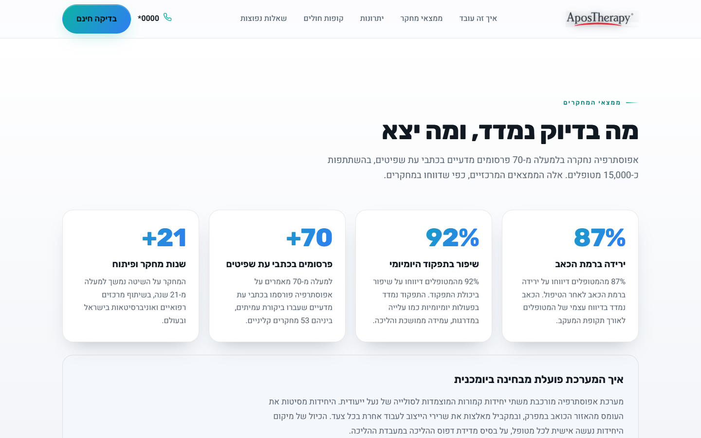
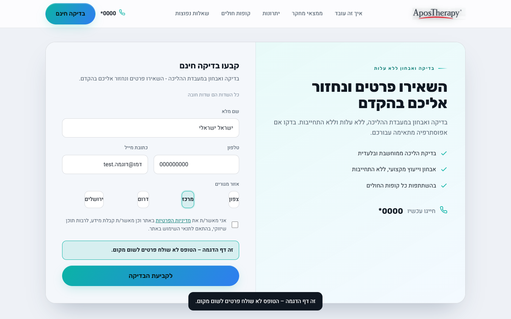
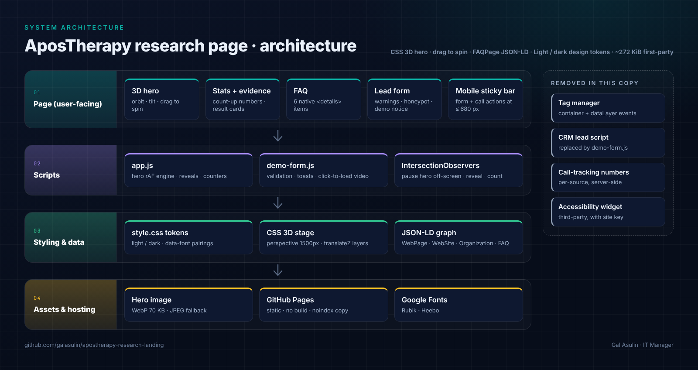
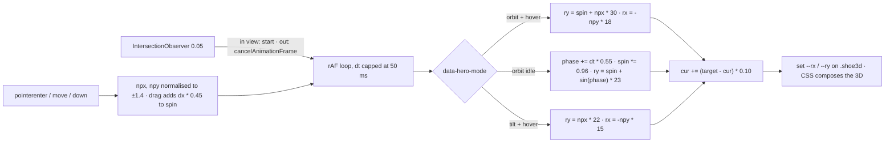

<p align="center"><a href="https://galasulin.github.io/apostherapy-research-landing/"></a></p>

<div align="center">

# AposTherapy · Research-Led Landing Page

**A lead page that opens with the clinical evidence, fronted by an interactive CSS 3D product card you can hover, tilt and drag to spin.**

🇬🇧 English · 🇮🇱 [עברית](README.he.md)

[](https://galasulin.github.io/apostherapy-research-landing/)


<br>


[Live demo](https://galasulin.github.io/apostherapy-research-landing/) · [Screens](#screens) · [Architecture](#architecture) · [Tech](#technical-parameters)

<sub>On the live page, hover or drag the shoe card.</sub>

</div>

> **Showcase repository.** A sanitized, static copy of a landing page that runs in production on the company's domain. The tag manager, the CRM lead endpoint, the third-party accessibility widget and every real phone number were removed. The form still validates, but it never sends anything: a valid submit only shows a demo notice. See [Privacy & scope](#privacy--scope).

## At a glance

| | |
|---|---|
| **Type** | Lead-generation landing page, evidence-first |
| **Status** | Live in production on the company domain · this repo is the sanitized copy |
| **Stack** | HTML5 · CSS (3D transforms, custom-property tokens) · vanilla JavaScript · schema.org JSON-LD |
| **My role** | Content structure, visual system, front-end engineering, production hand-off |
| **Live demo** | [galasulin.github.io/apostherapy-research-landing](https://galasulin.github.io/apostherapy-research-landing/) |
| **Languages** | UI in Hebrew (RTL) · docs in English and Hebrew |

## Screens

<table>
  <tr>
    <td width="33%"><a href="assets/desktop-hero.png"></a><br><sub><b>Hero</b> · 3D product card with floating chips</sub></td>
    <td width="33%"><a href="assets/desktop-stats.png"></a><br><sub><b>Research numbers</b> · counters animate into view</sub></td>
    <td width="33%"><a href="assets/desktop-evidence.png"></a><br><sub><b>Evidence</b> · what was measured, and what came out</sub></td>
  </tr>
  <tr>
    <td width="33%"><a href="assets/desktop-form.png"></a><br><sub><b>Lead form</b> · region picker, consent, honeypot</sub></td>
    <td width="33%"><a href="assets/desktop-form-demo.png"></a><br><sub><b>Form (demo)</b> · demo notice and phone toast</sub></td>
    <td width="33%" align="center"><a href="assets/mobile.png"></a><br><sub><b>Mobile</b> · copy first, sticky bottom bar</sub></td>
  </tr>
</table>

## What it is

A lead page for AposTherapy, a non-surgical treatment for knee, back, hip and ankle pain. Instead of opening with benefits, it leads with **the evidence**: 87% reported less pain, 92% better function, 70+ peer-reviewed publications, 250,000+ patients. The page walks a sceptical visitor from the numbers, through *what was measured and how*, to the FAQ and a single form.

It was delivered as a **drop-in replacement folder** for the previous page: same form field names and the same hook classes (`.open-btn`, `.call-btn`, `.warning`, `.bdika-text`), so the existing production lead script kept working unchanged.

## Key capabilities

**Interactive 3D hero**
- The product photo sits on a card in real CSS 3D: `perspective: 1500px`, `transform-style: preserve-3d`, the card on `translateZ(40px)`, three glass chips on `translateZ(70 / 95 / 120px)`, a shadow on `-30px` and a floor ring tilted `rotateX(74deg)`.
- A small `requestAnimationFrame` engine in `app.js` drives it: an idle orbit sway (sine wave), pointer-follow tilt on hover, and **drag to spin** with momentum that decays (`spin *= 0.96`), all smoothed by lerp.
- Three modes (`orbit` / `tilt` / `stage`) switch with one attribute, `data-hero-mode`. `stage` is pure CSS keyframes with no JS loop.
- The loop pauses when the hero leaves the screen (`IntersectionObserver`) and calms down under reduced motion.

**Evidence-first content**
- Counters (`87%`, `92%`, `250,000+`, `70+`) count up with an ease-out-cubic curve when they scroll into view, formatted with `toLocaleString`.
- Four result cards plus a plain-language *how it works biomechanically* note and an honest results disclaimer, the angle this page was built for.
- Staggered scroll reveals: one observer adds `.in` to each `.reveal`; `data-d="1..4"` staggers the delays.

**FAQ for people and for search**
- A visible FAQ built on native `<details>` (keyboard accessible, no JS), mirrored in a `FAQPage` JSON-LD graph, so the same answers are available to rich results and AI answer engines.

**Design tokens**
- Every colour, radius, shadow and font is a CSS custom property. Light and dark token sets switch with `data-theme`, font pairings with `data-font` on `<html>`.
- Glass chips (`backdrop-filter`), a drifting mesh gradient and a masked grid give depth without extra images.

**Performance**
- The hero image is preloaded with `fetchpriority="high"`, served as WebP with a JPEG fallback (`<picture>` and CSS `image-set()`).
- Every image has explicit dimensions; below-the-fold images lazy-load.
- The YouTube video is a click-to-load facade: nothing is requested from YouTube until the visitor presses play, then `youtube-nocookie.com` is used.

**Accessibility**
- Skip link, visible focus rings, labelled fields, `role="radiogroup"` for the region, `role="alert"` warnings with `aria-invalid`, focus on the first invalid field, 44 px targets, a `noscript` fallback.
- `prefers-reduced-motion` turns off every animation and transition and shows all reveal content at once.

## Architecture



The page is static: `index.html` holds the markup and the JSON-LD graph, `style.css` holds the tokens, the 3D stage and the responsive rules, and two deferred scripts add behaviour. `app.js` (kept as it is in production) owns the nav state, the 3D hero engine, the reveals and the counters. `demo-form.js` replaces the production lead script: same validation and warning hooks, plus the demo toasts and the click-to-load video. The hero engine writes only two custom properties, `--rx` and `--ry`, on `.shoe3d`; CSS does all the 3D composition. Assets are plain files on GitHub Pages; on load the only external host is Google Fonts.

### Flow



## Technical parameters

| Parameter | Value |
|---|---|
| Source files | `index.html` 37,376 B · `style.css` 33,322 B (666 lines) · `app.js` 4,811 B (113 lines) · `demo-form.js` 4,510 B · `accessibility.html` 4,600 B |
| First-party page weight | 278,384 B (about 272 KiB) in a WebP-capable browser: HTML, CSS, both scripts, favicon, hero WebP, logos and icons. Fonts and the share image not counted |
| Hero image | `shoe-hero.webp` 1400 × 805, 70,242 B · JPEG fallback 1740 × 1000, 201,356 B |
| Other images | 4 health-fund logos (PNG, 75 px high) · brand logo 660 × 150 · 2 small icons · share image 1200 × 628 |
| 3D stage | height 620 px (520 at ≤ 980 px, 400 at ≤ 680 px) · `perspective: 1500px` · origin 50% 45% |
| Depth layers | card `translateZ(40px)` · chips 70 / 95 / 120 px · shadow −30 px · floor `rotateX(74deg)` |
| Hero engine | lerp 0.10 · spin decay 0.96 per frame · drag 0.45° per px · idle sway ±23° (Y), ±4° (X) · hover tilt ±30° / ±18° (orbit), ±22° / ±15° (tilt) · `dt` capped at 50 ms |
| CSS loops | float 7 s · orbit ring 14 s · mesh drift 18 s · sheen 2.4 s on hover |
| Counters | 4 values · 1,500 ms ease-out-cubic · start at 60% visibility |
| Reveals | threshold 0.16 · `rootMargin: 0px 0px -8% 0px` · stagger 80 / 160 / 240 / 320 ms |
| Structured data | JSON-LD `@graph`: `WebPage`, `WebSite`, `Organization`, `FAQPage` with 6 questions · 6 visible `<details>` items |
| Theming | light (default) and dark token sets · `data-font` pairings; the page loads Rubik + Heebo for the default pairing |
| Breakpoints | 440 · 680 · 980 · 1080 px · mobile sticky bar at ≤ 680 px |
| Fonts | Rubik 400 to 800 (display) · Heebo 300 to 800 (body) · Google Fonts with `display=swap` |
| External hosts | on load: `fonts.googleapis.com`, `fonts.gstatic.com` · after Play only: `youtube-nocookie.com` |
| Dependencies / build | none / none |

## Engineering decisions

- **CSS does the 3D, JS sets two numbers** → the engine only writes `--rx` / `--ry`; layering, depth and lighting stay in CSS, where they are easy to restyle. Trade-off: the 3D effect is a card in space, not a true 3D model.
- **Lerp toward a target instead of animating directly** → hover, drag and idle sway blend into one smooth motion without state machines. Momentum is one multiplication per frame.
- **Pause off-screen** → an `IntersectionObserver` cancels the rAF loop when the hero is not visible, so the page costs nothing while the visitor reads further down.
- **Visible FAQ mirrored in JSON-LD** → one source of answers serves people, rich results and AI answer engines. Trade-off: two copies to keep in sync.
- **Drop-in replacement with the old hooks** → keeping field names and hook classes let the production lead script, tracking and call-tracking keep working with no backend change.
- **Click-to-load video** → no third-party request and no cookies until the visitor asks for the video.

## Status and my role

**Live in production on the company domain.** This repo is a sanitized portfolio copy: tracking removed, form disconnected, phone numbers replaced with a fake `*0000` that only shows a demo notice. It is marked `noindex` so it never competes with the live page in search. In production it is a PHP page with server-side call-tracking numbers per traffic source, a tag manager and a CRM lead endpoint (all removed here).

I designed and built this page end to end: the research-first content structure, the visual system and the 3D hero, the interaction code, the structured data and the accessibility pass, and the production hand-off as a drop-in folder that kept the existing lead pipeline and tracking working.

## Repository layout

```
apostherapy-research-landing/
├── index.html          page + JSON-LD graph
├── style.css           design tokens, 3D stage, sections, responsive rules
├── app.js              3D hero engine, nav state, reveals, counters (as in production)
├── demo-form.js        demo form, toasts, click-to-load video; sends nothing
├── accessibility.html  short demo accessibility page
├── favicon.svg
├── images/             hero (WebP + JPEG), logos, fund logos, icons, share image
├── assets/             README screenshots
└── LICENSE
```

## Privacy & scope

| Removed / replaced | How |
|---|---|
| Tag manager container + `noscript` iframe, all `dataLayer` events | Removed |
| CRM lead endpoint, form keys, UTM / source passthrough (the old `script.js`) | Replaced by `demo-form.js`: same validation, no network request |
| jQuery from a public CDN (only the lead script needed it) | Removed |
| Server-side phone logic (a tracking number per ad source, a source that hides the phone) | Removed; every phone CTA is a fake, non-dialable `*0000` (no `tel:` link) that shows a demo notice |
| Star number and WhatsApp link in the `noscript` fallback | Replaced with the demo notice |
| Third-party accessibility widget (with its site key) | Removed |
| Accessibility statement with staff contact details | Not copied; replaced by `accessibility.html` without personal details |
| Embedded YouTube player | Replaced by a click-to-load poster; nothing is requested from YouTube until you press play |
| Company phone and social links in the structured data | Removed; `@id` / `url` point at this copy |
| Canonical / Open Graph URLs | Pointed at this GitHub Pages copy; page marked `noindex` |
| Outbound links to the company site (privacy, contact) | Disabled; they show a demo notice |
| `robots.txt`, `sitemap.xml`, `404.html`, server config, install notes, unused images | Not copied |
| Image metadata (EXIF / XMP / text chunks) | Stripped from every image |

The only external hosts the page loads are **Google Fonts** (`fonts.googleapis.com`, `fonts.gstatic.com`), plus YouTube's no-cookie domain only after the visitor presses play.

The AposTherapy / APOS names, logos and product photos belong to their owner and are shown with permission, for portfolio purposes only. View-only portfolio, see [LICENSE](LICENSE).

---

<div align="center"><b>Built by <a href="https://github.com/galasulin">Gal Asulin</a>, IT Manager</b></div>

<div align="center"><sub>Landing pages in this portfolio: <a href="https://github.com/galasulin/apos4-scroll-landing">apos4-scroll-landing</a> · <a href="https://github.com/galasulin/apos4-pods-landing">apos4-pods-landing</a> · <a href="https://github.com/galasulin/apostherapy-research-landing">apostherapy-research-landing</a></sub></div>
